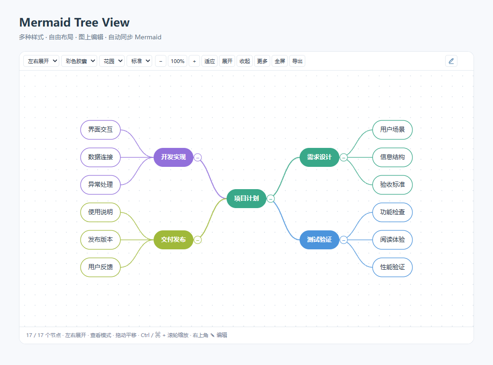
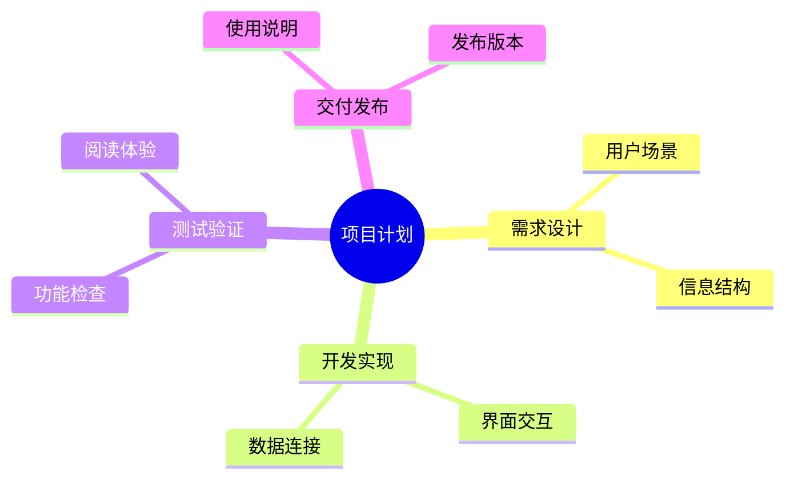

# Mermaid Tree View

让 Obsidian 中的 Mermaid 脑图更容易阅读和编辑。直接使用 Markdown 里的 `mermaid` 代码块，选择布局、配色和节点样式，在图上修改文字、添加节点或删除分支，并自动同步源码。

An Obsidian plugin for interactive Mermaid mindmaps, visual node editing and readable flowchart / ER diagram styles. Ready to install; no build tools or additional services required.



## 功能

- **多种布局**：自动适配、横向展开、左右展开、纵向树形、紧凑分列。
- **多种样式**：彩色胶囊、柔彩卡片、清透描边、线条脑图。
- **多套配色**：花园、海岸、秋日、糖果；支持亮色与暗色主题。
- **按图调整**：字号、节点宽度、层级距离、节点间距、画布高度、背景和连线形式。
- **查看与编辑**：默认查看，点击右上角铅笔进入编辑；编辑画布独立于实时预览区块，完成后回到笔记内。
- **图上编辑**：选择节点、双击改名、新增子节点或同级节点、删除分支、撤销修改，自动写回对应 Mermaid 块。
- **阅读操作**：拖动平移、缩放、适应窗口、折叠分支、搜索节点、全屏和导出 SVG。
- **紧凑工具栏**：单行排列；窄分栏可横向滚动。
- **流程图与 ER 图**：优化节点、判断框、连线、表头和字段的色彩层次，保留原生图的展示区域。

## 安装

需要 Obsidian **1.12.0 或更高版本**。

1. 从 [Releases](https://github.com/csw-chen/obsidian-mermaid-tree-view/releases) 下载 `mermaid-tree-view-2.4.0.zip`，或分别下载 `main.js`、`manifest.json`、`styles.css`。
2. 在笔记库中创建 `.obsidian/plugins/mermaid-tree-view/` 文件夹。
3. 将这三个文件直接放入该文件夹，不要多套一层目录。
4. 在 Obsidian 的「设置 → 第三方插件」中启用 **Mermaid Tree View**。

也可在 BRAT 中添加仓库地址 `csw-chen/obsidian-mermaid-tree-view`。

安装后无需 Node.js、Rust、构建命令或额外配置。GitHub 发布与 Obsidian 官方社区插件目录审核是两个独立步骤。

## 使用

在笔记中添加一个 Mermaid 脑图：

````markdown

````

在阅读模式或实时预览中打开笔记，即可使用图上的工具栏。每张图的显示设置分别保存，新图的默认设置可在插件设置页调整。

点击铅笔进入编辑后，单击选择节点，双击节点修改文字。编辑工具栏提供明确的新增、删除和撤销按钮。删除带有子节点的分支需要确认；中心节点不能删除，也不能新增同级节点。

| 操作 | 快捷键 |
| --- | --- |
| 新增子节点 | Tab / Insert |
| 新增同级节点 | Enter |
| 修改节点文字 | F2 / 空格 / 双击 |
| 删除选中节点或分支 | Delete / Backspace |
| 撤销本图内容修改 | Ctrl / ⌘ + Z |
| 选择相邻节点 | 方向键 |
| 选中中心节点 | Home |
| 保存正在输入的文字 | Enter |
| 取消正在输入的文字 | Esc |
| 放大 / 缩小 | + / −，或 Ctrl / ⌘ + 滚轮 |
| 适应画布 | 0 |

节点内容修改只写入对应的 Mermaid 代码块。插件内撤销保留本图最近 20 次内容修改，不回退笔记其他位置的正文。显示设置保存在插件的 `data.json` 中。

## 支持范围

图上编辑支持按缩进组织的单行 Mermaid `mindmap` 节点，可保留节点形状、注释及附属装饰。复杂的多行 Markdown 标签、制表符缩进及无法唯一定位的重复图，请使用源码编辑。

`flowchart` 和 `erDiagram` 使用样式优化；节点内容仍通过 Mermaid 源码修改。

全部处理在本地完成。插件不上传笔记，不使用网络服务，也不需要额外账号。

更多示例见 [examples.md](examples.md)。

## 开发与验证

`main.js` 就是可安装的插件入口，使用 Obsidian 提供的 API 和 Mermaid，不需要打包第三方运行时。

开发者可以使用 Node.js 执行：

```sh
node --check main.js
node check-layout.cjs
```

检查覆盖布局边界、长标签与深层结构、节点增删改、形状与注释保留、换行符、源块定位、并发冲突、编辑器事务和选区迁移。

作者：**csw** · [MIT License](LICENSE)
